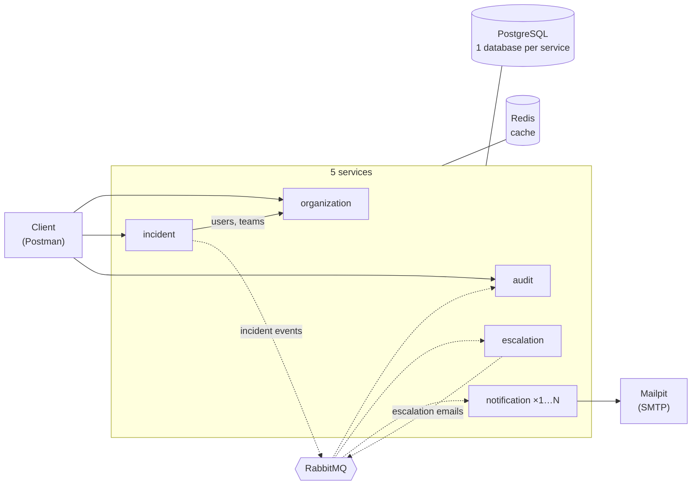
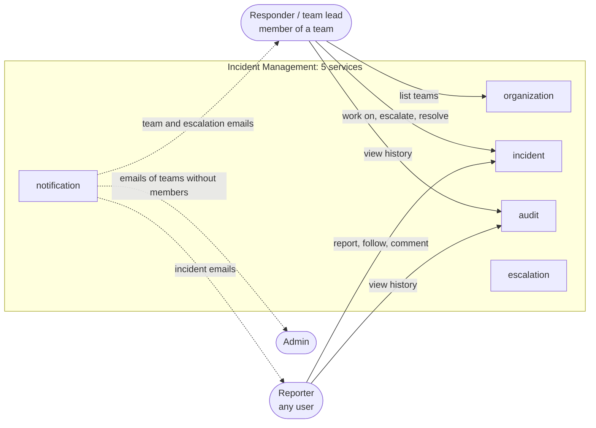

# ADR-0001 diagrams: general architecture

**Belongs to:** [ADR-0001: Migrate the modular monolith to event-driven microservices](0001-migrate-to-microservices.md)
**Date:** 2026-10-23 · **Status:** Proposed (same as the ADR)

**5 services** and **4 infrastructure containers**. Each service has its own database inside the one PostgreSQL
container. `notification-service` is the only service that runs more than one instance.

Arrows: **solid = REST**, **dotted = events via RabbitMQ**.

| Service | Exposed to clients | Role |
|---|---|---|
| organization | `GET /teams` | Users, teams, category routing; answers the other services over REST |
| incident | all incident endpoints | Incident lifecycle; publishes an event for every change |
| audit | `GET /incidents/{id}/history` | Stores the history from incident events |
| escalation | – | Turns escalation events into emails for each receiver |
| notification | – | Sends all emails; SEV1/SEV2 emails go first |

## Users

Who uses which service. Users send requests to only 3 services. Escalation and notification are internal; users
see them only as emails. The users are the same as in the monolith ([c4-model.md](../c4-model.md)), and every
request still carries `X-User-Id`.

Arrows: **solid = HTTP request**, **dotted = email**.

| User | Does | Gets emails when |
|---|---|---|
| Reporter | Reports incidents (up to SEV2), follows and comments on them, views their history | The incident is acknowledged, resolved, reopened, cancelled or (de-)escalated |
| Responder / team lead | Works on the team's incidents: status, severity (escalate / de-escalate, hand over), comments; lists teams | A new incident reaches the team, it is resolved / reopened / cancelled, or escalated to or away from the team |
| Admin | – | A team without active members gets an incident |
