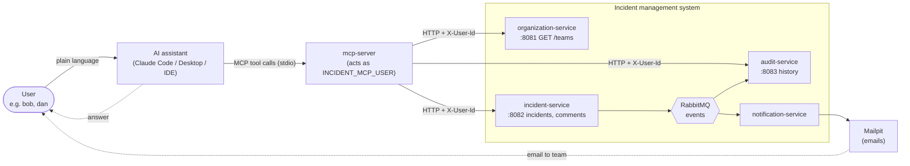
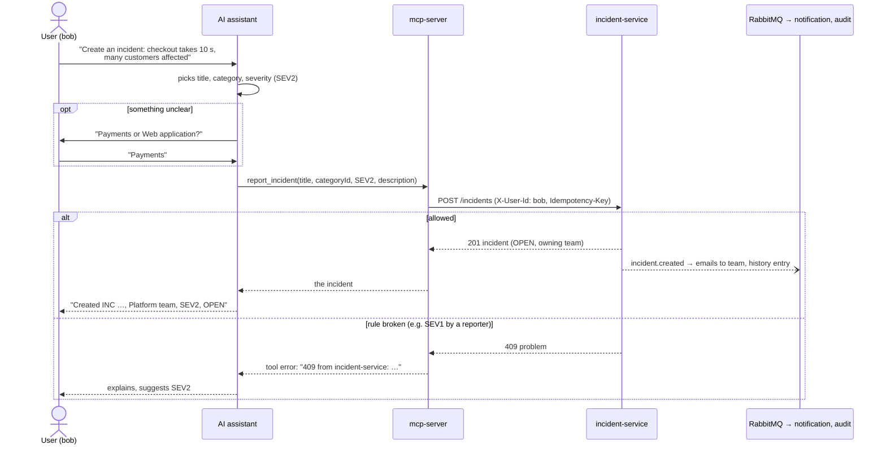
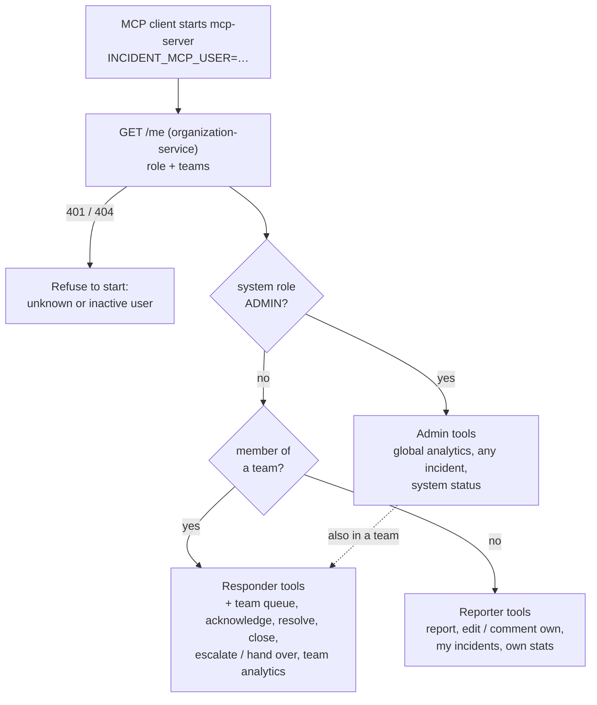

# ADR-0002 diagrams: the MCP server, the user and the system

**Belongs to:** [ADR-0002: Add an MCP server so AI assistants can do incident work](0002-add-mcp-server.md)
**Date:** 2026-11-20 · **Status:** Proposed (same as the ADR)

## 1. Who talks to whom

The user talks to an AI assistant in plain language. The assistant calls the MCP server's tools. The MCP server calls
only the **public** REST APIs, as the configured user. Everything after that (events, emails, history) happens inside
the system, exactly as for any other client.

Arrows: **solid = calls**, **dotted = what comes back to the user**.

The MCP server never touches databases, RabbitMQ, Redis or `/internal/**`.

## 2. "Create me an incident": one request, step by step

The service decides what is allowed; the MCP server only passes the request on and explains the answer.

## 3. At start-up: the user's role decides the tools

The assistant only ever sees the tools of its user's role. The services still check every request (ADR-0002 D4,
D5).
